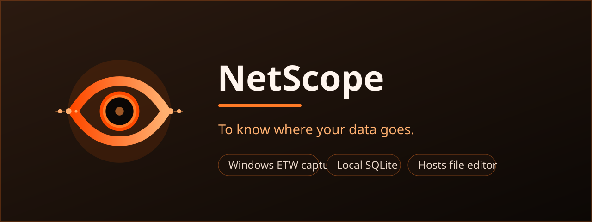

# NetScope — Network Monitor & Malicious Request Detector



A local-first Windows desktop monitor that records the network activity of the
whole machine - inbound and outbound - and flags suspicious behaviour. Built
with Flutter and the Yaru (Ubuntu) UI.

> Short name: **NetScope**. **100% local:** no server, no telemetry, no
> cloud. Captured data stays in a SQLite database on your device.

## What it does

- Captures every TCP/UDP endpoint plus the Windows DNS client cache.
- Attributes each flow to a process (PID, name, executable path).
- Shows live flows in a master-detail table: time, direction, process, target,
  protocol, state and risk score.
- Scores each event with metadata-based heuristics and exposes the reasons.
- Keeps history in SQLite and lets you export the current view as JSON.
- Includes a hosts-file editor with per-entry enable/disable checkboxes, and
  right-click actions to block or redirect an event's domain after UAC approval.

HTTPS payload contents stay encrypted: the monitor works on connection and DNS
metadata, not on decrypted traffic.

## How capture works

| Phase | Source | Notes |
|---|---|---|
| Primary (Phase 2) | ETW: `Microsoft-Windows-Kernel-Network` + `Microsoft-Windows-DNS-Client` via `netscope-capture.exe` | Realtime connect/accept, UDP, DNS answers, process attribution |
| Fallback (Phase 1) | `netstat -ano` + `Get-CimInstance Win32_Process` + `Get-DnsClientCache` | No admin, no driver; short-lived connections can be missed |
| Later (Phase 4) | Npcap (optional) | TLS SNI, JA3/JA4, HTTP metadata |

The helper self-elevates through UAC and streams NDJSON to the app over
loopback TCP; the app itself stays unelevated. If elevation is declined, the
app automatically falls back to polling. See
`docs/CAPTURE-ARCHITECTURE.md`.

## Detection signals

Blocklisted domain/IP, direct-IP connections with no DNS name, non-standard
destination ports, DGA-like domains, DNS-tunneling patterns, processes running
from temporary folders, and inbound connections from public addresses. Each
signal carries a weight; the total maps to `info` / `low` / `medium` / `high` /
`critical`. See `docs/DETECTION-ENGINE.md`.

## Quick start

Prerequisites: Flutter SDK with Windows desktop enabled.

```powershell
python tools/run_windows.py            # debug run
python tools/run_windows.py --analyze  # analyze first
python tools/run_windows.py --release  # release run
python tools/run_windows.py --build-only
```

The app starts monitoring automatically on launch. The first ETW capture asks
for administrator rights (UAC) so `netscope-capture.exe` can read kernel network
events; if you decline, it falls back to polling. Use **Stop monitoring** in
the sidebar to pause.

## Storage

```
%LOCALAPPDATA%\NetScope\network.db     events + allowlist
%LOCALAPPDATA%\NetScope\settings.json  settings
```

## Project structure

```
flutter-desktop-app/            Flutter desktop app (Yaru)
  lib/
    main.dart                   bootstrap + theme
    app_state.dart              capture state, filters, groups, paging
    models.dart                 NetworkEvent, Direction, Severity, RiskReason
    log_database.dart           SQLite persistence
    capture/
      capture_coordinator.dart  ETW-first capture with polling fallback
      etw_service.dart          loopback client for netscope-capture.exe
      capture_service.dart      polling capture source
      detection.dart            risk scoring engine
      blocklist.dart            bundled blocklist
      helper_locator.dart       finds netscope-capture.exe
    hosts/
      hosts_file.dart           hosts parser, editor model and serializer
      hosts_service.dart        elevated read/apply bridge
    ui/                         sidebar, table, hosts editor, dialogs, widgets
native/netscope_capture/        C++ ETW + hosts helper
installer/netscope.iss          Inno Setup installer
branding/                       canonical logo, icons and store artwork
tools/                          run/build helpers
docs/                           plan, capture architecture, detection engine
```

## Roadmap

Phase 0 (rebrand, extension removal), Phase 1 (polling capture, new model, new
UI) and Phase 2 (ETW helper integration, self-elevation, fallback) are
complete. Phase 3 (detection/alerts/allowlist UX), Phase 4 (Npcap deep mode)
and Phase 5 (release hardening) remain. Details in `docs/PROJECT-PLAN.md` and
`docs/STATUS.md`.

## Author

**AMiran Kimadze (itsarmen)**
GitHub: <https://github.com/itsarmen> · Email: <amoswaper@gmail.com> ·
Web: <https://xrow.asia>

## License

MIT - see `LICENSE`. Keep the copyright notice and author headers in any copy
or derivative work. Use of the software is also subject to `AGREEMENT.md`.
